# ⬡ AssurChain — Système Décentralisé de Gestion des Assurances sur Blockchain

<p align="center">
  
  
  
  
  
  
  
</p>

---

## 📌 Présentation Générale

**AssurChain** est une application décentralisée (**DApp**) de gestion des assurances développée sur la blockchain **Ethereum**. Son objectif est d'apporter une **transparence totale**, une **traçabilité infalsifiable** et une **automatisation complète** du cycle de vie des polices et sinistres en remplaçant les intermédiaires centralisés par un contrat intelligent (**Smart Contract Solidity**).

Le projet couvre l'ensemble de la chaîne de valeur assurantielle :
- 📋 **Création et émission de polices** par des assureurs agréés
- 🚨 **Déclaration des sinistres** par les assurés avec pièces justificatives (hachage IPFS)
- ⚖️ **Traitement et audit des dossiers** (mise en examen, approbation ou rejet motivé)
- 💸 **Remboursement automatique en ETH** directement sur le portefeuille de l'assuré, sans intervention manuelle

---

## 🎯 Chiffres Clés du Projet

<p align="center">
  <b>29 / 29 (100%)</b> Tests Unitaires &nbsp;•&nbsp; 
  <b>5</b> Types d'Assurance &nbsp;•&nbsp; 
  <b>3</b> Rôles On-chain &nbsp;•&nbsp; 
  <b>Instantané</b> Remboursement Automatique en ETH
</p>

---

## 📸 Démonstration & Captures d'Écran

### 1. Tableau de Bord (Vue Propriétaire)
Interface de supervision globale affichant la balance du pool de fonds, le nombre de polices actives, les sinistres en cours et l'adresse du contrat.
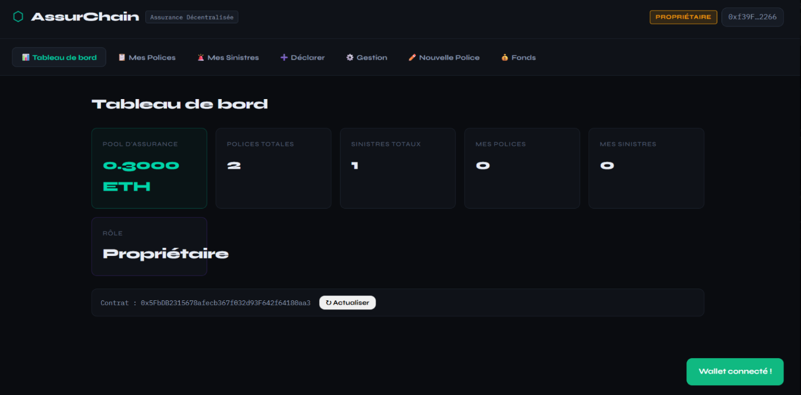

### 2. Gestion du Pool de Fonds
Dépôt et approvisionnement en ETH du pool d'assurance utilisé pour indemniser automatiquement les sinistres validés.
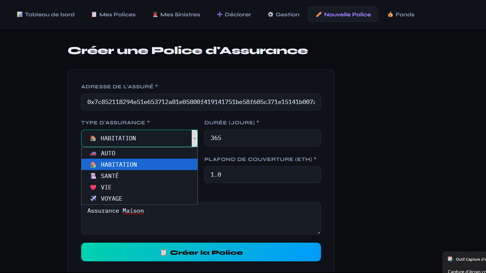

### 3. Création d'une Police d'Assurance (Vue Assureur)
Formulaire permettant à un assureur accrédité d'émettre une police pour une adresse bénéficiaire avec type, prime, plafond de couverture et durée.
<p align="center">
  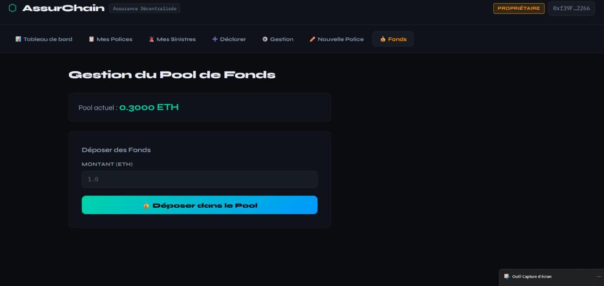
  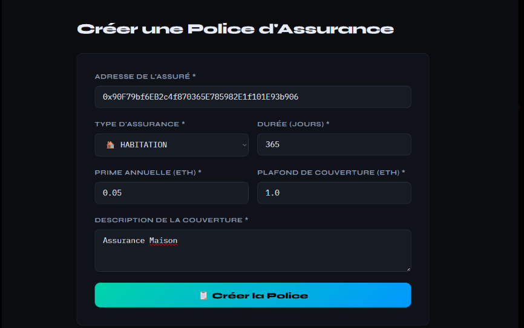
</p>

### 4. Espace Assuré : Consultation des Polices & Déclaration
L'assuré consulte ses polices actives et dispose d'un formulaire pour soumettre un sinistre avec montant réclamé et justificatif IPFS.
<p align="center">
  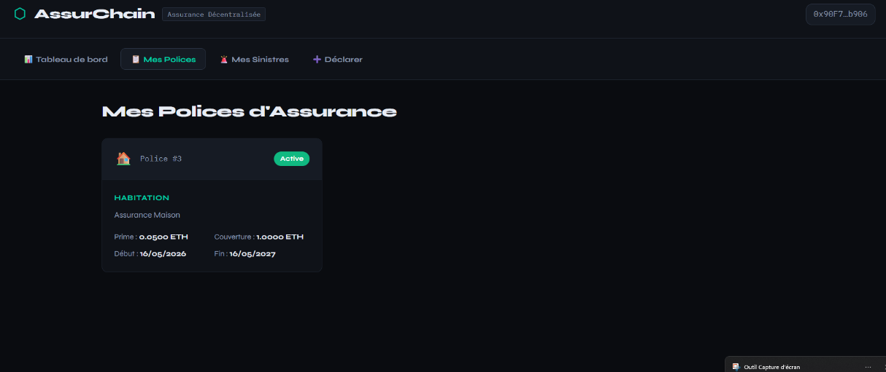
  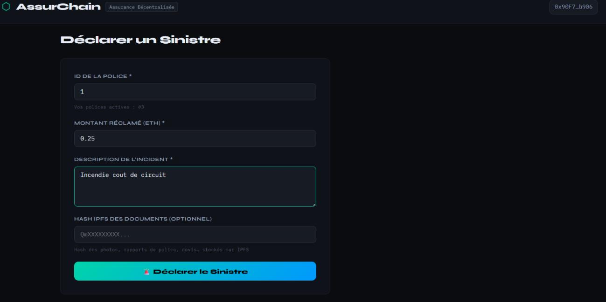
</p>
<p align="center">
  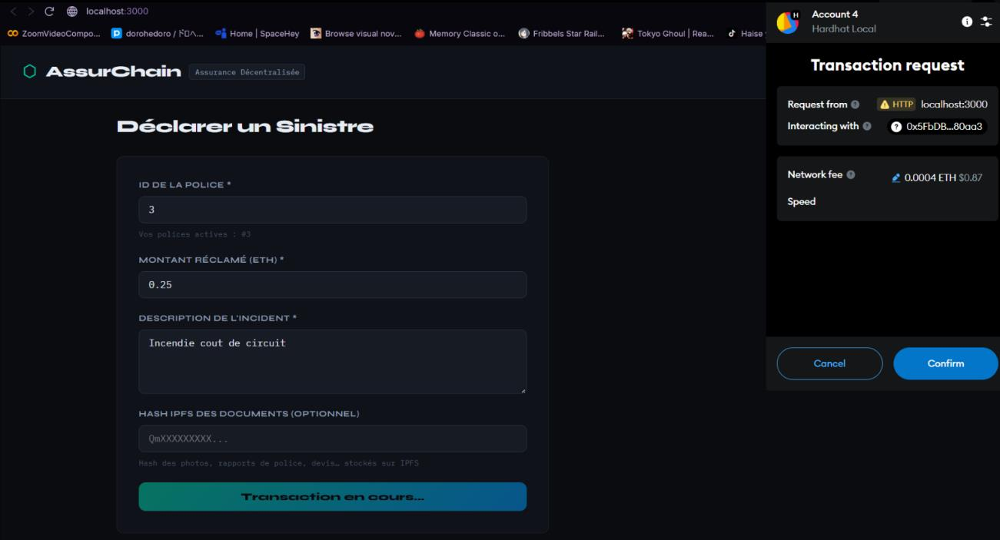
</p>

### 5. Suivi & Traitement des Sinistres (Côté Assuré & Assureur)
Suivi en temps réel de l'état d'avancement du dossier et tableau de bord assureur avec actions contextuelles (*Examiner*, *Approuver*, *Rejeter*).
<p align="center">
  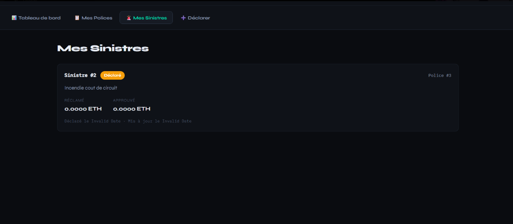
  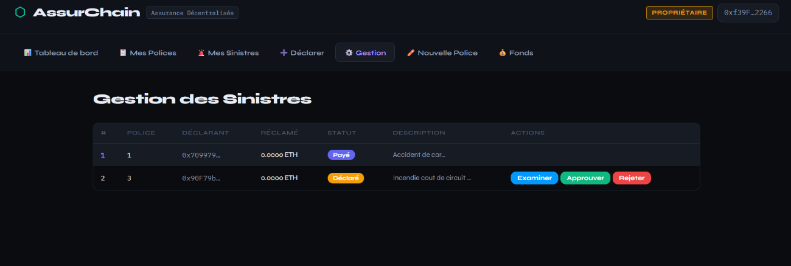
</p>
<p align="center">
  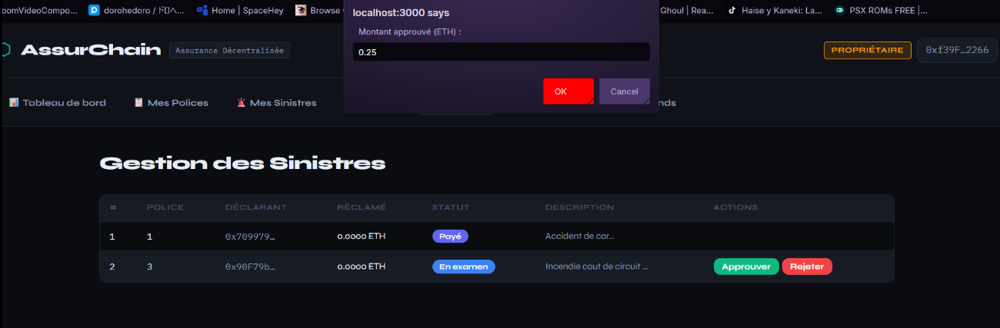
</p>

### 6. Remboursement Automatique en ETH & Validation On-Chain
Dès validation par l'assureur, le paiement déclenche le virement automatique d'ETH vers le portefeuille de l'assuré.
<p align="center">
  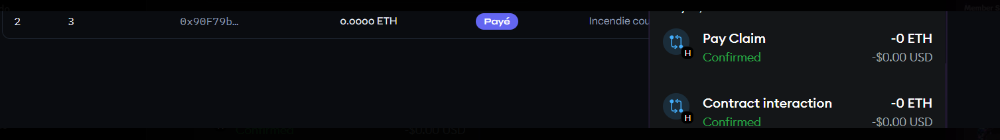
</p>

---

## 🏗️ Architecture du Projet

```
insurance-app/
├── contracts/
│   └── InsuranceManager.sol        # Contrat intelligent principal (Solidity 0.8.20)
├── scripts/
│   ├── deploy.js                   # Script de déploiement automatique + export ABI/adresses
│   └── seed.js                     # Script de peuplement de données de test
├── test/
│   └── InsuranceManager.test.js    # Suite complète de 29 tests unitaires
├── frontend/
│   ├── public/
│   │   └── index.html              # Point d'entrée HTML
│   └── src/
│       ├── App.js                  # Interface utilisateur React & logique Web3
│       ├── App.css                 # Feuilles de style modernes (thème sombre)
│       ├── InsuranceManagerABI.json# ABI du contrat synchronisée
│       ├── deployInfo.json         # Métadonnées réseau et adresse du contrat
│       └── index.js
├── docs/
│   └── screenshots/                # Captures d'écran de l'application
├── hardhat.config.js               # Configuration Hardhat & compilateur
├── package.json                    # Dépendances Node.js
└── .env.example                    # Exemple de variables d'environnement
```

---

## 📑 Modèle de Données & Smart Contract

### Modèle de Données (`InsuranceManager.sol`)

#### Types d'assurance (`InsuranceType`)
- `AUTO` (0)
- `HABITATION` (1)
- `SANTE` (2)
- `VIE` (3)
- `VOYAGE` (4)

#### Structure d'une Police (`Policy`)
```solidity
struct Policy {
    uint256 id;
    address insured;          // Adresse de l'assuré
    InsuranceType insType;    // Type d'assurance
    uint256 premium;          // Prime annuelle en wei
    uint256 coverageAmount;   // Plafond de couverture maximum en wei
    uint256 startDate;        // Timestamp de début
    uint256 endDate;          // Timestamp d'expiration
    PolicyStatus status;      // ACTIVE, EXPIRED, CANCELLED, SUSPENDED
    string description;       // Description de la couverture
}
```

#### Structure d'un Sinistre (`Claim`)
```solidity
struct Claim {
    uint256 id;
    uint256 policyId;         // Police associée
    address claimant;         // Adresse du déclarant
    uint256 declaredAt;       // Horodatage de déclaration
    uint256 updatedAt;        // Horodatage de mise à jour
    uint256 claimedAmount;    // Montant réclamé en wei
    uint256 approvedAmount;   // Montant validé pour indemnisation
    ClaimStatus status;       // DECLARED, UNDER_REVIEW, APPROVED, REJECTED, PAID
    string description;       // Détail de l'incident
    string ipfsDocHash;       // Empreinte IPFS des pièces justificatives
    string reviewNotes;       // Remarques de l'expert assureur
}
```

---

## 🔄 Cycle de Vie d'un Sinistre

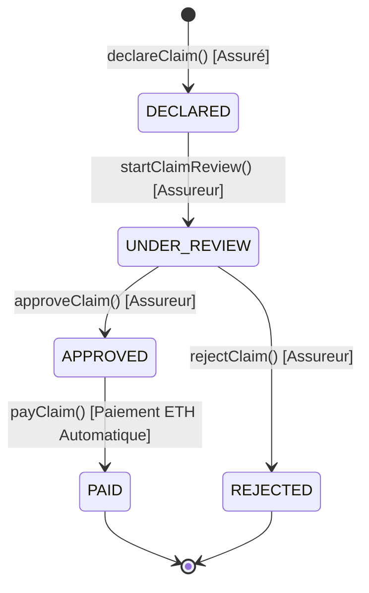

### Fonctions Clés & Contrôle d'Accès

| Fonction | Rôle Requis | Description |
|---|---|---|
| `createPolicy(...)` | **Assureur** | Crée une police d'assurance pour un assuré donné |
| `updatePolicyStatus(id, status)` | **Assureur** | Modifie le statut d'une police (Active, Suspendue, Annulée) |
| `declareClaim(...)` | **Assuré** (titulaire) | Déclare un sinistre adossé à une police active valide |
| `startClaimReview(id, notes)` | **Assureur** | Passe le sinistre en cours d'examen avec annotations |
| `approveClaim(id, amount, notes)` | **Assureur** | Approuve le sinistre et définit le montant indemnisable |
| `rejectClaim(id, reason)` | **Assureur** | Rejette le sinistre avec motif explicite |
| `payClaim(id)` | **Assureur** | Déclenche le transfert automatique d'ETH vers l'assuré |
| `depositFunds()` | **Tous** (Payable) | Approvisionne le pool de réserve d'indemnisation |
| `withdrawFunds(amount)` | **Propriétaire** | Retire des fonds du pool de liquidités |
| `addInsurer(address)` | **Propriétaire** | Habilite un nouvel assureur dans la whitelist |
| `removeInsurer(address)` | **Propriétaire** | Révoque les droits d'un assureur |

---

## 🛡️ Bonnes Pratiques & Sécurité

- **Pattern CEI (Checks-Effects-Interactions)** : L'état interne du contrat (`ClaimStatus.PAID`, déduction de la balance du pool) est systématiquement actualisé **avant** l'appel de transfert externe en ETH (`call{value: ...}`), immunisant contre les attaques de réentrance.
- **Auditabilité complète On-Chain** : Émission d'événements indexés pour chaque mutation d'état (`PolicyCreated`, `ClaimDeclared`, `ClaimStatusUpdated`, `ClaimPaid`, etc.).
- **Modificateurs de contrôle stricts** : `onlyOwner`, `onlyInsurer`, `onlyPolicyHolder`, `policyExists`, `claimExists`.
- **Compilateur optimisé** : Solidity `0.8.20` avec optimiseur activé (`runs: 200`) et cible EVM `paris`.

---

## 🚀 Installation & Démarrage Rapide

### Prérequis
- [Node.js](https://nodejs.org/) (version ≥ 18)
- Extension navigateur [MetaMask](https://metamask.io/)

### 1. Installation des Dépendances
```bash
# Dépendances principales (Hardhat & contrats)
npm install

# Dépendances de l'interface React
cd frontend && npm install && cd ..
```

### 2. Démarrage du Nœud Local Ethereum
Dans un premier terminal :
```bash
npx hardhat node
```
> Cette commande initialise une blockchain locale avec 20 comptes pré-alimentés à 10 000 ETH. Le compte `#0` correspond au Propriétaire / Assureur initial.

### 3. Configuration de MetaMask
1. Ouvrir MetaMask → **Ajouter un réseau** manuellement :
   - **Nom du réseau** : `Hardhat Local`
   - **URL RPC** : `http://127.0.0.1:8545`
   - **ID de chaîne** : `31337`
   - **Symbole** : `ETH`
2. Importer le **Compte #0** (Propriétaire/Assureur) via sa clé privée affichée dans la console.
3. Importer le **Compte #1** ou `#2` (Assuré) pour tester la bascule entre les rôles.

### 4. Déploiement du Smart Contract
Dans un second terminal :
```bash
npx hardhat run scripts/deploy.js --network localhost
```
> Le script déploie `InsuranceManager`, injecte 0.5 ETH dans le pool et synchronise automatiquement l'ABI et l'adresse dans `frontend/src/deployInfo.json`.

### 5. (Optionnel) Injection des Données de Test
```bash
npx hardhat run scripts/seed.js --network localhost
```
> Crée automatiquement 3 polices (AUTO, HABITATION, SANTE) et 2 sinistres avec démonstration du cycle de traitement.

### 6. Lancement de l'Application Web
```bash
cd frontend
npm start
```
L'application s'ouvre sur **http://localhost:3000**.

---

## 🧪 Tests Unitaires

La suite de tests automatisée valide la totalité des flux nominaux et des cas d'erreur.

```bash
# Exécution des 29 tests unitaires
npm test

# Analyse de couverture de code
npm run test:coverage

# Rapport d'estimation de consommation de gas
REPORT_GAS=true npm test
```

### Résultats des Tests :
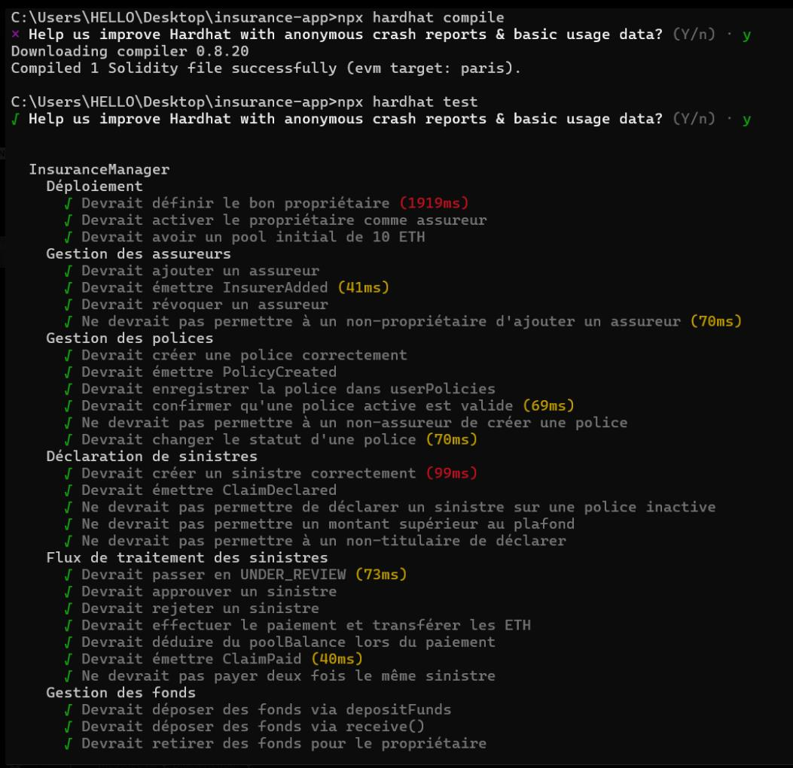
```text
  InsuranceManager
    Déploiement
      ✔ Devrait définir le bon propriétaire
      ✔ Devrait activer le propriétaire comme assureur
      ✔ Devrait avoir un pool initial de 10 ETH
    Gestion des assureurs
      ✔ Devrait ajouter un assureur
      ✔ Devrait émettre InsurerAdded
      ✔ Devrait révoquer un assureur
      ✔ Ne devrait pas permettre à un non-propriétaire d'ajouter un assureur
    Gestion des polices
      ✔ Devrait créer une police correctement
      ✔ Devrait émettre PolicyCreated
      ✔ Devrait enregistrer la police dans userPolicies
      ✔ Devrait confirmer qu'une police active est valide
      ✔ Ne devrait pas permettre à un non-assureur de créer une police
      ✔ Devrait changer le statut d'une police
    Déclaration de sinistres
      ✔ Devrait créer un sinistre correctement
      ✔ Devrait émettre ClaimDeclared
      ✔ Ne devrait pas permettre de déclarer un sinistre sur une police inactive
      ✔ Ne devrait pas permettre un montant supérieur au plafond
      ✔ Ne devrait pas permettre à un non-titulaire de déclarer
    Flux de traitement des sinistres
      ✔ Devrait passer en UNDER_REVIEW
      ✔ Devrait approuver un sinistre
      ✔ Devrait rejeter un sinistre
      ✔ Devrait effectuer le paiement et transférer les ETH
      ✔ Devrait déduire du poolBalance lors du paiement
      ✔ Devrait émettre ClaimPaid
      ✔ Ne devrait pas payer deux fois le même sinistre
    Gestion des fonds
      ✔ Devrait déposer des fonds via depositFunds
      ✔ Devrait déposer des fonds via receive()
      ✔ Devrait retirer des fonds pour le propriétaire
      ✔ Ne devrait pas permettre le retrait par un non-propriétaire

  29 passing (10s)
```

---

## 🌐 Déploiement sur Testnet (Sepolia)

1. Créer un fichier `.env` à la racine (voir `.env.example`) :
   ```env
   SEPOLIA_RPC_URL=https://sepolia.infura.io/v3/VOTRE_API_KEY
   PRIVATE_KEY=votre_cle_privee_sans_0x
   ```
2. Obtenir des ETH de test Sepolia sur un robinet (ex: [sepoliafaucet.com](https://sepoliafaucet.com/)).
3. Lancer le déploiement :
   ```bash
   npx hardhat run scripts/deploy.js --network sepolia
   ```

---

## 🔮 Axes d'Amélioration & Roadmap

Conformément à l'analyse de fin de projet :
- [ ] **Sécurité accrue** : Intégration du composant `ReentrancyGuard` d'OpenZeppelin sur `payClaim` et `withdrawFunds`.
- [ ] **Automatisation des cotisations** : Implémentation d'une fonction `payPremium()` permettant le prélèvement périodique des primes.
- [ ] **Gouvernance Décentralisée** : Remplacement de l'administrateur unique (EOA) par un contrat multisig (Gnosis Safe) ou une DAO.
- [ ] **Expérience Utilisateur (UI)** : Remplacement des fenêtres `prompt()` natives du navigateur par des modales interactives dédiées et modularisation du composant React `App.js`.

---

## 📄 Licence

Ce projet est sous licence **MIT**. Libre d'utilisation, de modification et de distribution dans le cadre de vos projets académiques et professionnels.
